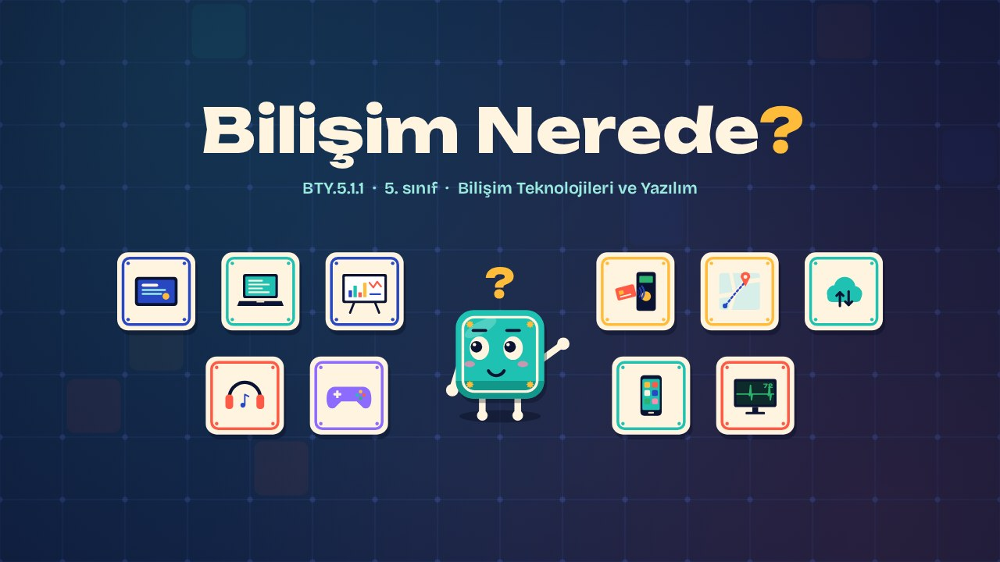
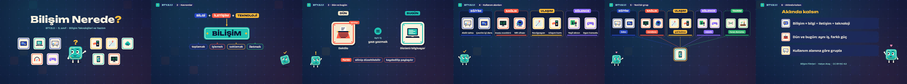

# Bilişim Nerede? · Where Is IT?

**▶ Tarayıcıda izleyin / Watch in the browser:** https://hakanatas.github.io/bilisim-nerede/ 
**⬇ MP4 + altyazılar / MP4 + subtitles:** [Releases](https://github.com/hakanatas/bilisim-nerede/releases) 
**✎ Kullanılan istem / The prompt behind it:** [PROMPT.md](PROMPT.md) 
**🎞 Bütün filmler / All films:** [Bilişim Filmleri](https://hakanatas.github.io/bilisim-filmleri/?sinif=5)

> **TR —** 5. sınıf Bilişim Teknolojileri ve Yazılım dersinin "Bilişim Teknolojilerinin Hayatımızdaki Yeri" temasındaki BTY.5.1.1 öğrenme çıktısı için hazırlanmış, tamamen JavaScript ile çizilen 2,5 dakikalık (150 sn) animasyon; ses efektleri ve hafif fon müziği de kodla üretilir. Sabah alarmıyla uyanan Karo'nun etrafı bilişim teknolojileriyle dolar. Önce dört temel kavram tanıtılır: bilgi (işimize yarayan anlamlı haber), iletişim (bilginin birinden diğerine ulaşması), teknoloji (işi kolaylaştıran araç ve yöntemler) ve bunların birleşimi olan bilişim (bilgiyi toplamak, işlemek, saklamak, iletmek); BİT kısaltması açıklanır. Sonra geçmiş ve bugünkü teknolojiler karşılaştırılır: daktilo ile dizüstü bilgisayar, teyp ile akıllı telefon, ilk bilgisayarlar ile bulut bilişim; iş aynıdır, boyut, hız ve bağlantı farklıdır. Ardından sekiz teknoloji kullanım alanlarına göre eğitim, sağlık, ulaşım ve eğlence raflarına ayrılır. Hiçbir rafa uymayan tarım dronu için yeni bir grup açılır ve akıllı telefonun birçok alanda kullanıldığı gösterilir. Altyazılar Türkçe, İngilizce ya da ikisi birlikte seçilebilir.

A 2.5-minute animation, with code-generated sound effects and a quiet background tune, for **5th-grade IT and Software** (Türkiye Yüzyılı Maarif Modeli). The guide is **Karo**, a living glazed tile who never speaks: he tells the story with his face, his arms and the blinking cursor that floats above his head (│ ? ! … ✓ ♥). He moves by tipping over his own edge. The whole series uses a "çini-piksel" look: Iznik tile colours (cobalt, turquoise, coral red, saffron, emerald) on a deep navy tiled ground, because a pixel and a tile are both the smallest square of a picture.

## Öğrenme çıktısı · Learning outcome

MEB, Türkiye Yüzyılı Maarif Modeli, Bilişim Teknolojileri ve Yazılım Dersi Öğretim Programı, 5. sınıf, 1. tema "Bilişim Teknolojilerinin Hayatımızdaki Yeri":

**BTY.5.1.1. Günlük yaşamda kullanılan bilişim teknolojilerini sınıflandırabilme**
- a) Bilişim teknolojilerine ilişkin temel kavramları belirler.
- b) Geçmişten günümüze bilişim teknolojilerindeki benzerlikleri ve farklılıkları ilişkilendirir.
- c) Bilişim teknolojilerini kullanım alanlarına göre gruplandırır.

## Sahneler · Scenes

| # | Zaman | Sahne | Ne oluyor | Çıktı |
|---|---|---|---|---|
| 1 | 0:00–0:16 | Günaydın | Alarm çalar, Karo uyanır; etrafı günlük bilişim teknolojileriyle dolar. | a |
| 2 | 0:16–0:46 | Kavramlar | Bilgi, iletişim, teknoloji; üçü birleşince bilişim: toplamak, işlemek, saklamak, iletmek. BİT. | a |
| 3 | 0:46–1:15 | Dün ve bugün | Daktilo ↔ dizüstü, teyp ↔ akıllı telefon, ilk bilgisayarlar ↔ bulut bilişim: aynı iş, farklı güç. | b |
| 4 | 1:15–1:44 | Kullanım alanları | Sekiz teknoloji eğitim, sağlık, ulaşım ve eğlence raflarına ayrılır. | c |
| 5 | 1:44–2:10 | Yeni bir grup | Tarım dronu hiçbir rafa uymaz: "Tarım" grubu açılır. Akıllı telefon beş alanda da kullanılır. | c |
| 6 | 2:10–2:30 | Aklında kalsın | Bilişim = bilgi + iletişim + teknoloji; dün ve bugün; kullanım alanına göre grupla. | a–c |

## Çalıştırma · Running it

- **Önizleme:** `index.html` dosyasına çift tıklayın (çevrim dışı da çalışır). Klavye: boşluk oynat/duraklat, ← → 2 sn, Home başa. Adrese `?altyazi=en` ya da `?bicim=vertical` eklenebilir.
- **MP4:** bir kez `npm install`, sonra `npm run export -- --format=both --captions=tr` (720p yatay ve dikey, sesli; sessiz için `--no-audio`). Google Chrome yüklüyse Playwright onu kullanır (`channel: 'chrome'`); ffmpeg gerekir.
- **Altyazı ve seslendirme notları:** `npm run srt` → `out/bilisim-nerede_tr.srt`, `_en.srt`, `_tr-en.srt`, `_seslendirme-notlari.txt`.
- **Sürüm dosyaları:** `npm run release` → `release/` klasöründe v1.0'ın 6 dosyası.
- **Yazı kontrolü:** `npm run check` her 0,25 saniyede, yatay ve dikey düzende, üç altyazı seçeneğiyle üst üste binen, kenardan taşan ya da 720p'de 17 pikselden küçük kalan yazı arar.
- **Düzenleme:**
  - Altyazılar, zamanlar ve seslendirme notları: `captions.js`
  - Sahneler: `scenes/film.js` (her sahne bir fonksiyon; `L.pick(yatay, dikey)` iki düzen arasında seçer)
  - Karo'nun pozları ve ifadeleri: `src/draw/karo.js`; ikonlar: `src/draw/icons.js`; renk tokenları: `src/draw/palette.js`
  - Hız: `film.config.js` içindeki `DURATION` (sahneler 92 sn'lik hikâye zamanıyla yazılır, film bu süreye yayılır)
  - Ses: efekt olayları `scenes/film.js` sonundaki `BF.CUES`, sesler ve müzik `src/audio/synth.js`

Her kare `renderFrame(t)` ile zamanın saf fonksiyonu olarak çizilir; rastgelelik tohumludur, MP4 ekran kaydı değil kare kare üretimdir. Ses de dosyadan çalınmaz: Karo'nun sözsüz "bip"leri, karo pop'ları, uçuş ve yerine oturma sesleri, sahne geçişindeki karo dalgası ve sakin kalimba melodisi aynı olay listesinden hesaplanır; tarayıcıdaki oynatıcı ile MP4'teki ses aynıdır. Oynatıcıda ses açılıp kapatılabilir (`?ses=0`). Yazı tipleri: Unbounded ve Bricolage Grotesque (SIL OFL 1.1), dosyaya gömülü.

## Lisans · License

**TR —** Bu film ve kodu [Creative Commons Atıf-GayriTicari 4.0 Uluslararası (CC BY-NC 4.0)](https://creativecommons.org/licenses/by-nc/4.0/deed.tr) lisansıyla paylaşılır. Ticari olmayan her amaçla (derste, okulda, eğitim materyalinde) kopyalayabilir, paylaşabilir ve değiştirebilirsiniz; ancak **kaynak göstermek zorunludur**: eser sahibinin adı ve bu deponun bağlantısı belirtilmeden kullanılamaz. Ticari kullanım (satış, ücretli ürün ya da yayın) için izin alınmalıdır.

**EN —** This film and its code are licensed under [Creative Commons Attribution-NonCommercial 4.0 International (CC BY-NC 4.0)](https://creativecommons.org/licenses/by-nc/4.0/). You may copy, share and adapt them for non-commercial purposes, but **attribution is required**: they may not be used without crediting the author and linking to this repository. Commercial use requires permission.

Atıf örneği / Required credit: *“Bilişim Nerede?”, Hakan Ataş, Bilişim Filmleri — https://github.com/hakanatas/bilisim-nerede — CC BY-NC 4.0*
